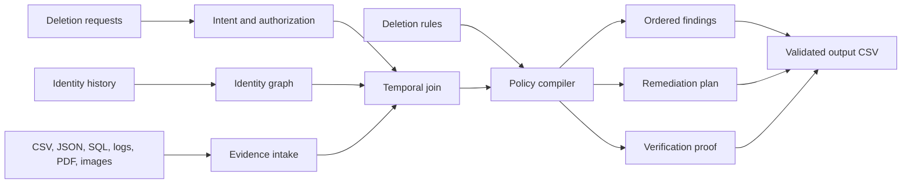

# GhostTrace

### Evidence-first deletion auditing for distributed customer data

GhostTrace is a deterministic Python audit agent for the HackerRank Orchestrate challenge **Ghost Data Still Exists**. It reconstructs whether a customer deletion request is truly complete across primary databases, replicas, search indexes, analytics, support systems, exports, logs, backups, and active data flows.

The project treats deletion as a proof obligation, not a workflow status. A successful deletion job is only a claim; GhostTrace looks for contemporaneous evidence of the actual resource state and compiles the ordered actions and verification checks still required.

## What it does

- Resolves current and historical customer identifiers without fuzzy email matching.
- Reads CSV, JSON, SQLite-compatible SQL, logs, PDFs, and optional image evidence.
- Builds a temporal identity-to-resource evidence graph.
- Reconstructs state at each request's `audit_at` cutoff.
- Applies `deletion_rules.csv` category by category.
- Detects active synchronization and backup-restore risks.
- Preserves retained security records while removing prohibited direct identifiers.
- Handles account tombstones, replica drift, redaction, anonymization, deletion, and verification.
- Emits strict, ordered JSON steps in the challenge's required CSV schema.
- Includes public-sample evaluation, authored regression cases, validation, and token-usage reporting.

## Architecture



If Mermaid is not supported by the viewer, the flow is: **requests + identity history + evidence + deletion rules → temporal evidence join → policy compiler → findings, remediation, and verification → validated output CSV**.

The core pipeline is local and deterministic. Optional model hooks can assist ambiguous intent or screenshot extraction, but models never control destructive actions, policy ordering, or the final schema.

Download the [presentation-ready architecture graphic](docs/architecture.png) for a portfolio post or project walkthrough. The editable [SVG version](docs/architecture.svg) is also included.

## Run it with the official dataset

The challenge dataset is intentionally not committed to this public repository. Place the official `dataset/` directory beside `code/`, then run from the repository root:

```powershell
python code/main.py --dataset dataset --output output.csv --usage-report code/evaluation/usage_report.md
python code/validate.py --requests dataset/deletion_requests.csv --output output.csv
python -m unittest discover -s code/tests -v
python code/evaluation/run_eval.py --dataset dataset
```

The generated file is:

```text
case_id,deletion_status,steps_json
```

The production package is also available as `code.zip` in the local submission workspace, but generated challenge artifacts and private traces are excluded from this portfolio repository.

## Evaluation snapshot

On the supplied public 32-case sample, the repaired engine measured:

| Metric | Result |
| --- | ---: |
| Status accuracy | 96.88% |
| Step precision | 79.52% |
| Step recall | 68.39% |
| Step F1 | 73.54% |
| Exact step-array accuracy | 34.38% |
| Authored regression status accuracy | 100.00% |
| Authored regression sequence accuracy | 100.00% |

These are reproducible engineering measurements, not a claim about hidden-test or leaderboard performance.

## Design principles

### Evidence beats workflow claims

`SUCCESS`, `COMPLETE`, and deletion-worker events are not treated as proof of absence. Direct reads, point-in-time snapshots, and policy readbacks receive higher authority.

### Time is part of identity resolution

Every observation is filtered against the request's `audit_at` timestamp. Historical email aliases and other identifiers remain linked to the stable internal user identity.

### Retention is not deletion failure

Security and legally retained records stay available when policy requires them. GhostTrace verifies that they remain present while checking that prohibited direct identifiers are redacted.

### Plans are safe and explainable

GhostTrace proposes ordered operations. It never performs real deletion, never fabricates evidence, and leaves future remediation and verification evidence blank as required by the contract.

## Repository layout

```text
code/
├── main.py                       # Evidence graph and plan compiler
├── validate.py                   # Output contract validator
├── evaluation/
│   ├── evaluate.py               # Metrics
│   ├── run_eval.py               # Public sample + regression workflow
│   ├── custom_eval.py            # Authored fixtures
│   ├── evaluation_report.md      # Measured evaluation report
│   └── usage_report.md           # Runtime model/token report
└── tests/test_agent.py           # Four regression scenarios
docs/architecture.md              # Detailed implementation notes
```

## Privacy and licensing

Do not commit the official challenge dataset, customer evidence, API keys, `.env` files, authentication files, agent traces, or submission outputs. The repository is intended as a public engineering portfolio and contains the implementation and documentation only.

The challenge corpus and evaluation labels remain governed by HackerRank's rules. Add a project license only after confirming that the code and any included assets are yours to license publicly.

## Interview summary

The short explanation is: **GhostTrace is a temporal evidence graph plus a policy compiler. It separates reported workflow state from observed resource state, resolves historical identities, detects recreation paths, and emits an ordered, evidence-cited remediation and verification plan.**
